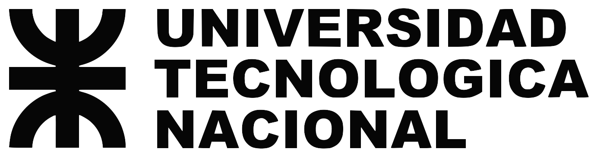

<p align="center">
  
</p>

<h1 align="center">Sostenibilidad y Software Libre en el Aula</h1>

<p align="center">
  <strong>Una propuesta tecno-pedagógica para la optimización del aprendizaje y la autonomía en la Tecnicatura Superior en Análisis de Sistemas del ISFT N° 151</strong>
</p>

<p align="center">
  <a href="https://gabrielinuz.github.io"></a>
  
  
</p>

---

## ⧉ Información Académica

Este repositorio alberga la presentación web interactiva, la documentación metodológica y los recursos informáticos correspondientes a la **Defensa Oral de Tesina de Grado** para la obtención del título de **Licenciado en Tecnología Educativa**.

| Metadato Académico | Detalle |
| :--- | :--- |
| **Institución** | Universidad Tecnológica Nacional – Facultad Regional Buenos Aires (UTN FRBA) |
| **Carrera** | Licenciatura en Tecnología Educativa (LTE) |
| **Autor** | **Gabriel Nicolás González Ferreira** (Legajo: `2015780` \| DNI: `29.495.326`) |
| **Contacto** | [gabrielinuz@gmail.com](mailto:gabrielinuz@gmail.com) |
| **Director** | **Dr. Gustavo Eduardo Carr** (Facultad de Ingeniería – UNMDP) |
| **Fecha de Defensa** | 12 de Noviembre de 2026 — 20:30 hs |
| **Modalidad** | Exposición Virtual (Plataforma Zoom) |

---

## ⧉ Síntesis de la Investigación

El presente trabajo aborda la problemática de la **fricción didáctica** en la enseñanza de la programación dentro de la educación superior técnica. A partir de una intervención mediante **Investigación-Acción (I-A)** en el ISFT N° 151, se reemplazaron los entornos privativos pesados (Windows + Visual Studio Code) por una propuesta tecno-pedagógica basada en **Software Libre y Software Austero** (Debian GNU/Linux + ICEWM + Geany) sobre hardware antiguo recuperado del plan Conectar Igualdad.

### Resultados Clave:
* **Fluidez Didáctica:** Erradicación del 100% de los tiempos muertos por congelamiento y esperas de compilación en el grupo intervenido.
* **Carga Cognitiva:** Reducción drástica del estrés técnico, aumentando la iteración activa de experimentación en clase al **90%**.
* **Autonomía y Soberanía:** El **90%** de los estudiantes del Grupo Intervenido decidió adoptar GNU/Linux en sus computadoras personales para continuar su formación de manera independiente.

---

## ⧉ Archivos y Estructura del Repositorio

```text
.
├── index.html                          # Aplicación Web SPA con la presentación interactiva (18 filminas + 5 anexos)
├── doc/
│   ├── GUION_DE_DEFENSA_LTE.pdf        # Guion oral detallado por diapositiva (Formato PDF)
│   └── GUION_DE_DEFENSA_LTE.pptx       # Guion oral detallado por diapositiva (Formato PPTX)
├── imagenes/                           # Imágenes que se usan en la defensa.
├── referencias/                        # Referencias que se citan en la defensa.
└── README.md                           # Documentación principal del repositorio
```

---

## ⧉ Instrucciones para la Visualización Interactiva

La presentación principal (`presentacion_defensa.html`) está desarrollada bajo el estándar **Single Page Application (SPA)** sin dependencias pesadas, totalmente optimizada para proyectores y navegadores modernos.

### Controles de Navegación:
* **Flecha Derecha (`→`) / Barra Espaciadora:** Avanzar a la siguiente diapositiva.
* **Flecha Izquierda (`←`):** Retroceder a la diapositiva anterior.
* **Botón `PDF` (Navegación Fija):** Invoca el renderizado optimizado de impresión (`@media print`), exportando únicamente las 18 diapositivas principales formales (excluyendo automáticamente los anexos de respaldo).
* **Botón Pantalla Completa (`[  ]`):** Alterna el modo *Fullscreen*.
* **Teclado Escape (`Esc`):** Cierra visores emergentes o ventanas de zoom de imágenes.

---

<p align="center">
  <em>Desarrollado con compromiso tecno-pedagógico y filosófico por el Software Libre.</em><br>
  <strong>UTN FRBA — 2026</strong>
</p>